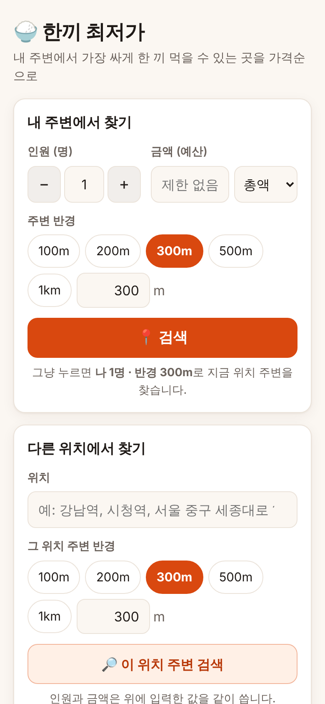
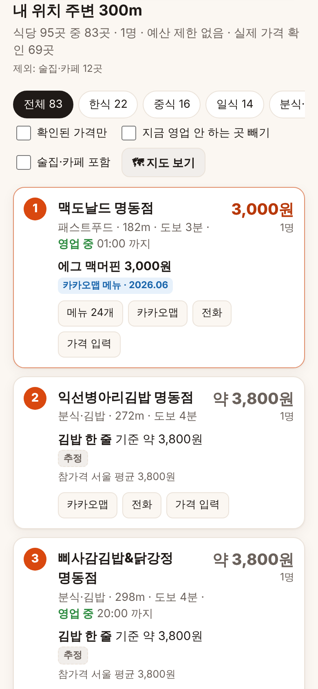
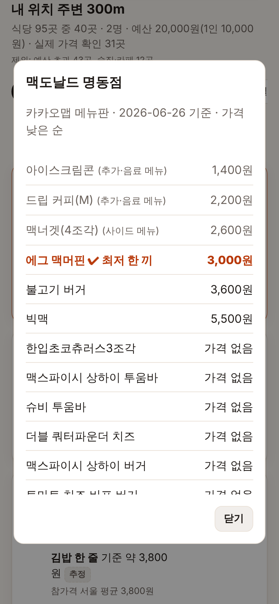

# 🍚 한끼 최저가

내 주변(또는 입력한 위치 주변)에서 **가장 싸게 한 끼 먹을 수 있는 식당**을 가격순으로 보여주는 앱입니다.
일반 식당, 기사식당, 한식뷔페, 구내식당, 분식·김밥, 중식, 패스트푸드 등 음식점을 빠짐없이 모은 뒤
각 식당의 **실제 메뉴판 가격**으로 "1인 최저 한 끼" 가격을 계산해 줄 세웁니다.

- **인원수 · 금액(예산) · 반경**을 넣고 검색 → 예산 안에서 가격 낮은 순으로 표시
- 아무것도 안 바꾸고 **검색**만 누르면 → **나 1명 · 반경 300m · 지금 위치**
- 아래 **다른 위치에서 찾기** 칸에 "강남역", "서울 중구 세종대로 110"처럼 입력 → 그 위치 주변 반경 검색
- 휴대폰 화면에 맞춘 웹앱이라 홈 화면에 추가하면 앱처럼 쓸 수 있습니다 (PWA)

| 검색 화면 | 결과 (가격순) | 메뉴판 |
| --- | --- | --- |
|  |  |  |
| 인원·금액·반경 입력, 그 아래 위치 입력 | 1인 가격 × 인원 = 총액, 가격 출처 표시 | 어떤 메뉴가 최저 한 끼인지, 무엇을 뺐는지 |

---

## 휴대폰에서 쓰기: GitHub 시크릿 + Cloudflare Pages (추천)

학원비교 앱처럼 키를 **GitHub 시크릿**에 넣으면 GitHub Actions가 무료 **Cloudflare Pages**에 자동으로 배포합니다 → **https://hankki.pages.dev**
컴퓨터를 켜 둘 필요가 없고, https 주소라 **휴대폰에서 내 위치(GPS) 검색**과 **입력한 위치 주변 검색**이 그때그때 실시간으로 됩니다.
카카오 키는 GitHub 시크릿 → Cloudflare 비밀값으로만 옮겨지고, 화면 파일이나 휴대폰에는 가지 않습니다.

저장소 **Settings → Secrets and variables → Actions → New repository secret** 에 세 개를 넣습니다.

| Name | 값 |
| --- | --- |
| `KAKAO_REST_API_KEY` | 카카오 개발자 사이트의 **REST API 키** |
| `CLOUDFLARE_ACCOUNT_ID` | Cloudflare **Account home** → 계정 이름 옆 **⋯ → Copy account ID** (또는 대시보드 주소 `dash.cloudflare.com/` 뒤의 32자리) |
| `CLOUDFLARE_API_TOKEN` | Cloudflare 오른쪽 위 사람 아이콘 → **My Profile → API Tokens → Create Token → Custom token(Get started)** → Permissions: `Account` · `Cloudflare Pages` · `Edit` → Account Resources: 내 계정 → **Continue to summary → Create Token** |

그다음 **Actions → 앱 배포 → Run workflow**. 끝나면 실행 결과의 **Summary**에 주소가 나옵니다. 휴대폰에서 열고 **홈 화면에 추가**하세요.

- Cloudflare 에서 **Create application 은 누르지 않아도 됩니다.** Actions가 `hankki` 프로젝트를 자동으로 만듭니다.
- `hankki` 라는 이름을 다른 사람이 이미 쓰고 있으면 Cloudflare 가 `hankki-○○○.pages.dev` 처럼 뒤에 글자를 붙입니다. 실제 주소는 Summary 에 나옵니다.
- 코드가 바뀌어 이 브랜치에 올라오면 자동으로 다시 배포됩니다. 키를 바꿨을 때는 **Run workflow** 를 다시 하세요.
- 무료 플랜은 하루 10만 번 요청까지라 혼자 쓰기에 충분합니다. 다만 검색 한 번에 카카오에 물어볼 수 있는 횟수에 제한이 있어,
  식당이 아주 많은 곳을 넓게(1km 이상) 검색하면 일부만 나올 수 있습니다. 그때는 화면에 안내가 나오니 반경을 줄여 주세요.
- 주소를 아는 사람은 누구나 열 수 있습니다(검색 엔진에는 안 뜨게 막아 두었습니다). 키는 보이지 않습니다.

## 내 컴퓨터에서 켜서 쓰기


### 시작하기 (처음 한 번)

**1. Node.js 설치** — [nodejs.org](https://nodejs.org)에서 **LTS** 버전을 받아 기본값으로 설치합니다. (다른 프로그램은 필요 없습니다)

**2. 프로젝트 받기** — 이 저장소 페이지에서 초록색 **`<> Code` → Download ZIP** 을 눌러 받고 압축을 풉니다.

**3. 실행** — 압축 푼 폴더에서 더블클릭합니다. 서버가 켜지고 브라우저가 자동으로 열립니다.
   - 윈도우: **`start-windows.bat`**
   - 맥: **`start-mac.command`** (처음에 "확인되지 않은 개발자" 경고가 나오면 파일을 오른쪽 클릭 → **열기**)

**4. 카카오 키 넣기** — 앱 화면 맨 위 **🔑 카카오 API 키 넣기** 칸에 REST API 키를 붙여넣고 **저장**합니다.
   - 키가 맞는지 카카오에 바로 확인한 뒤 이 컴퓨터의 `.env` 파일에 저장하고, 서버를 다시 켜지 않아도 **즉시 적용**됩니다.
   - 키 받는 곳: [카카오 개발자](https://developers.kakao.com/console/app) → 내 애플리케이션 → (없으면 애플리케이션 추가하기) → 내 앱 → **앱 키** → **REST API 키**
   - "카카오맵(로컬) 사용 설정이 꺼져 있습니다"라는 안내가 나오면 개발자 사이트의 앱 설정에서 **카카오맵** 사용 설정을 켜 주세요.
   - 나중에 키를 바꾸려면 화면 맨 아래 **🔑 카카오 API 키 넣기 / 바꾸기** 버튼을 누르세요.

다음부터는 3번(더블클릭)만 하면 됩니다. 끌 때는 검은 창에서 **Ctrl + C** 를 누르거나 창을 닫습니다.

> 명령어로 실행해도 됩니다: 폴더에서 `npm start` → 브라우저로 http://localhost:3000

### 휴대폰에서 쓰기

- 서버를 켠 컴퓨터와 **같은 와이파이**에 있는 휴대폰에서, 서버 시작 시 검은 창에 나오는 `http://192.168.x.x:3000` 주소로 접속할 수 있습니다. (카카오 키는 컴퓨터에서만 넣을 수 있습니다)
- 단, 휴대폰 브라우저는 **https 주소에서만 현재 위치(GPS)**를 허용합니다. http 주소에서는 "다른 위치에서 찾기"에 위치를 직접 입력해 쓰거나,
  아래 방법 중 하나로 https 주소를 만드세요.
  - [Cloudflare Tunnel](https://developers.cloudflare.com/cloudflare-one/connections/connect-networks/do-more-with-tunnels/trycloudflare/): `cloudflared tunnel --url http://localhost:3000` → 나오는 `https://….trycloudflare.com` 주소로 접속
- 접속한 뒤 브라우저 메뉴에서 **홈 화면에 추가**하면 앱 아이콘이 생깁니다.

---

## 가격은 어떻게 정하나요?

식당마다 아래 순서로 가격 출처를 하나 고르고, 결과 카드에 출처와 기준 날짜를 표시합니다.

| 순서 | 출처 | 설명 |
| --- | --- | --- |
| 1 | **직접 확인** | 내가 카드의 "가격 입력"으로 저장한 가격 (내 브라우저에만 저장) |
| 2 | **카카오맵 메뉴** | 식당이 카카오맵에 올린 메뉴판 가격 (메뉴 갱신 날짜 표시) |
| 3 | **착한가격업소** | 행정안전부·지자체 착한가격업소 공공데이터 (가져온 경우) |
| 4 | **추정** | 메뉴 정보가 없으면 업종별 평균 가격으로 추정 — 회색 "약 ○원"으로 구분 |

"확인된 가격만" 체크박스를 켜면 추정 가격 식당은 숨깁니다.

### "최저 한 끼"를 고르는 규칙

메뉴판에서 단순히 가장 싼 항목을 고르면 공기밥·음료·초밥 1개 같은 것이 뽑히기 때문에, 실제 명동 일대 식당 메뉴판으로 확인하며 다음 규칙을 만들었습니다.

- 빼는 것: 공기밥·사리·추가 메뉴, 음료·주류·커피·디저트, 반찬·튀김·계란찜·너겟·감자튀김 같은 사이드, 어린이·경로 요금
- 낱개 가격 (`(1ea)`, `2알`, `4pcs` 등 8개 미만)과 100g당 가격 (`마라탕(100g)`)은 한 끼가 아님 → 메뉴판에 한 끼 메뉴가 없으면 추정 가격 사용
- 만두 한 접시·주먹밥은 전문점이 아니면 곁들이로 봄, 닭갈비집 `볶음밥` 추가(4,500원 미만)도 제외
- `2인 세트 26,000원` → 1인 13,000원으로 나눔. 단 `(2인 이상)`, `(2인분부터)`는 최소 주문 표기라 나누지 않음
- 같은 가게 메뉴 중 하위 25% 가격의 절반보다 싼 메뉴는, 이름에 식사 단어(찌개·국밥·정식·김밥·짜장 등)가 없으면 곁들이로 봄
- 2,500원 미만은 한 끼로 보지 않음

### 정렬: 싼 곳 먼저 / 맛집 먼저 / 가성비 먼저

검색 칸 아래와 결과 위에서 고를 수 있습니다. 어느 쪽이든 **인원·예산 조건은 그대로** 지킵니다.

- **싼 곳 먼저** (기본): 1인 한 끼 가격이 싼 순서
- **맛집 먼저**: 카카오맵 평점·리뷰 수·블로그 리뷰 수·"맛" 추천 수로 매긴 점수 순서. 리뷰가 적은 곳의 높은 평점은 전체 평균(3.6) 쪽으로 보정해서, 리뷰 2개짜리 5.0 이 리뷰 300개짜리 4.5 보다 앞서지 않습니다. 평점이 없는 곳은 뒤로 갑니다.
- **가성비 먼저**: 맛집 점수에서 1인 가격이 8천원보다 2배 비쌀 때마다 점수를 깎아, 평이 좋으면서 싼 곳이 위로 옵니다. 리뷰가 없는 곳은 평균보다 낮게 봅니다.
- 리뷰 10개 이상이고 점수가 높은 곳에는 **맛집** 표시가 붙습니다. 점수 기준은 `public/ranking.js` 에 있습니다.

카드의 **메뉴 ○개** 버튼을 누르면 전체 메뉴와 각 메뉴를 왜 뺐는지 볼 수 있습니다.
인원이 2명 이상이면 `1인 최저가 × 인원`으로 총액을 계산하고, 예산(총액 또는 1인당)을 넘는 곳은 뺍니다.

### 추정 가격 고치기

`data/price-estimates.json` 에 업종별 추정 가격이 있습니다. 숫자를 바꾸고 서버를 다시 시작하면 반영됩니다.
(김밥 3,800원, 자장면 7,692원, 김치찌개 백반 8,654원, 칼국수 10,038원은 한국소비자원 참가격 서울 평균 기준)

---

## 착한가격업소 데이터 넣기 (선택)

착한가격업소는 정부·지자체가 "가격이 착한 가게"로 지정한 곳이라 이 앱과 잘 맞습니다.

1. [공공데이터포털](https://www.data.go.kr)에서 **착한가격업소**로 검색 → 원하는 지역 CSV 파일 다운로드
2. 가져오기:

```bash
npm run import:goodprice -- 받은파일1.csv 받은파일2.csv
# 위도·경도가 없는 파일은 주소로 좌표를 찾아 넣기
npm run import:goodprice -- --geocode 받은파일.csv
```

- 지자체마다 컬럼이 달라도(`업소명/상호`, `도로명주소/주소/소재지`, `메뉴1·가격1…`, `위도·경도` 등) 자동으로 인식합니다. EUC-KR 파일도 됩니다.
- 미용·세탁·숙박 같은 음식점이 아닌 업종은 빠집니다.
- 지도 검색 결과와 같은 가게는 **착한가격업소** 배지가 붙고, 지도 데이터에 없는 업소는 결과에 따로 추가됩니다.

---

## 설정 (.env)

| 이름 | 기본값 | 설명 |
| --- | --- | --- |
| `KAKAO_REST_API_KEY` | (없음) | 카카오 REST API 키 (앱 화면에서 넣으면 자동으로 저장됨) |
| `PORT` | 3000 | 서버 포트 |
| `ENABLE_MENU_FETCH` | true | 카카오맵 메뉴 가격 가져오기 |
| `MENU_CONCURRENCY` | 4 | 메뉴를 동시에 몇 곳씩 가져올지 |
| `DETAIL_CACHE_HOURS` | 6 | 가져온 메뉴·영업시간을 저장해 두는 시간 |
| `MAX_PLACES` | 1000 | 한 번에 가격을 확인할 최대 식당 수 (가까운 순) |

반경은 50m~10km 까지 고를 수 있습니다. 반경 안 식당이 1,000곳 이하면 전부 모으고, 그보다 많으면(도심에서 1km 넘게) 가까운 곳과 싼 한 끼 종류(김밥·분식·기사식당·한식뷔페·구내식당·백반·국밥·칼국수·중국집·도시락·착한가격업소 등)를 반경 전체에서 찾습니다.

---

## 알아둘 점

- **카카오맵 메뉴 가격**은 카카오맵 장소 페이지가 쓰는 데이터를 읽어옵니다(공식 공개 API가 아님). 카카오가 형식을 바꾸면 메뉴 가격만 빠지고
  추정 가격으로 동작하며, `ENABLE_MENU_FETCH=false`로 끌 수 있습니다. 개인 용도로, 적은 양만 요청하도록 동시 요청 수와 캐시를 두었습니다.
- 메뉴판 가격은 식당이 갱신하지 않으면 오래된 가격일 수 있어 기준 날짜를 함께 보여줍니다. 방문 전에 한 번 더 확인해 주세요.
- 점심 특선·평일 한정 가격도 메뉴판에 있으면 최저가로 잡힙니다. 최소 주문 인원(2인분부터 등)은 반영하지 않습니다.
- "가격 입력"으로 저장한 내 가격은 지금 쓰는 브라우저에만 저장됩니다(다른 휴대폰·브라우저와 공유되지 않음).
- 영업 정보는 1시간 안에 확인한 것만 "영업 중/종료"로 표시합니다.
- 거리는 직선거리이며, 도보 시간은 분당 67m 기준입니다.

## 개발

```bash
npm test          # 테스트 (실제 카카오맵 응답 형식과 실제 메뉴판 사례로 검증)
npm run dev       # 파일이 바뀌면 자동 재시작
```

```
server.js                 서버 시작
src/app.js                API와 화면 파일 제공
src/search.js             검색 흐름 (장소 모으기 → 착한가격업소 합치기 → 가격 정하기)
src/pricing.js            최저 한 끼 메뉴 고르기, 가격 출처 우선순위, 업종별 추정
src/categories.js         식당 분류 (기사식당, 한식뷔페, 구내식당, 분식 …)
src/goodprice.js          착한가격업소 CSV 읽기와 식당 연결
src/providers/kakaoLocal.js   카카오 로컬 API (식당이 많으면 영역을 나눠 전부 수집)
src/providers/kakaoPlace.js   카카오맵 메뉴·영업시간
src/providers/osm.js          카카오 키가 없을 때 OpenStreetMap
src/kakaoKey.js           앱 화면에서 넣은 카카오 키 확인·저장
src/api.js                /api 처리 (PC 서버·Cloudflare 공통)
src/services.js           검색 서비스 조립 (공통)
src/cloudflare.js         Cloudflare 에서 /api 처리
functions/api/[[path]].js Cloudflare Pages Functions 진입점
wrangler.toml             Cloudflare Pages 설정
.github/workflows/deploy.yml  GitHub 시크릿으로 Cloudflare Pages 에 배포
start-windows.bat, start-mac.command   더블클릭 실행 파일
public/                   화면 (HTML/CSS/JS, PWA)
data/price-estimates.json 업종별 추정 가격
scripts/import-goodprice.js   착한가격업소 가져오기
```

### API

| 요청 | 설명 |
| --- | --- |
| `GET /api/places?lat=&lng=&radius=` | 반경 안 식당과 1차 가격 (캐시된 메뉴 가격 포함) |
| `POST /api/details` `{ places: [...] }` | 카카오맵 메뉴·영업시간을 가져와 가격 다시 계산 (최대 30곳) |
| `GET /api/geocode?q=` | 위치 이름/주소 → 좌표 후보 |
| `GET /api/status` | 설정 상태 |
| `POST /api/kakao-key` `{ key }` | 카카오 키 확인 후 `.env`에 저장 (서버 컴퓨터에서만 가능) |
